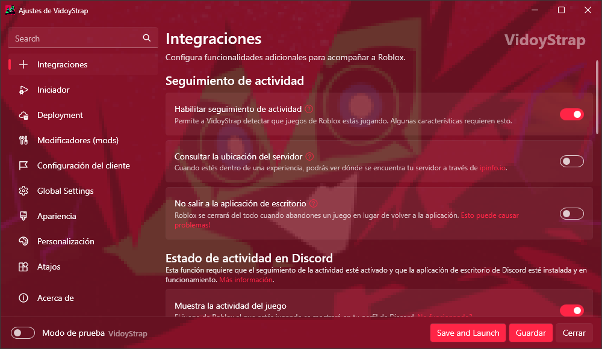
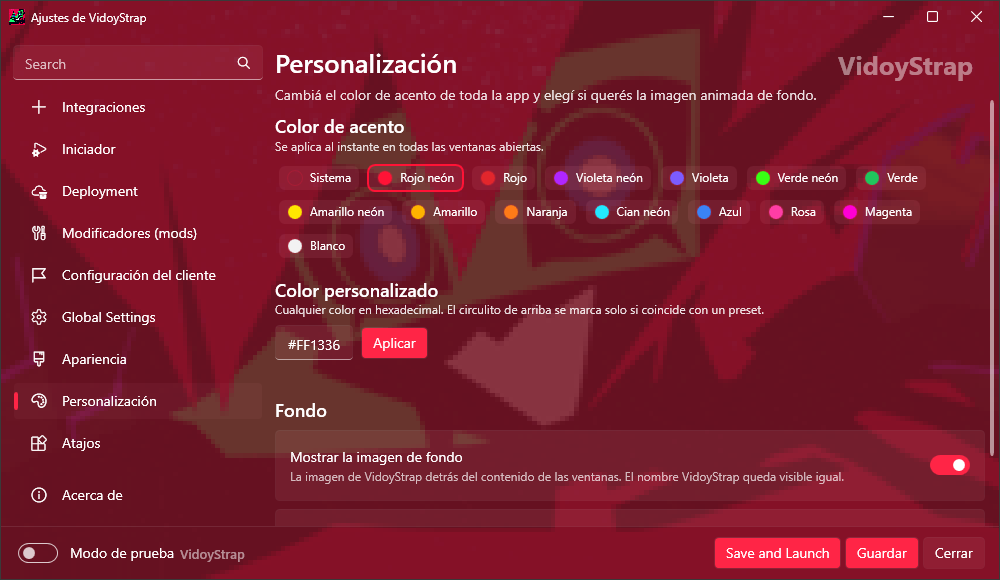
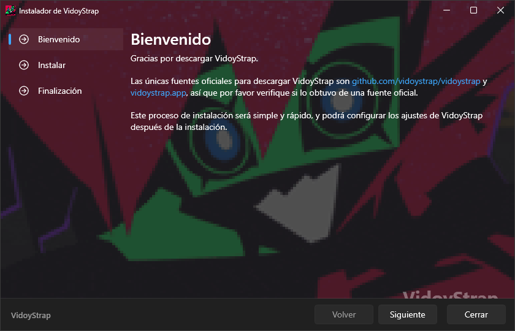
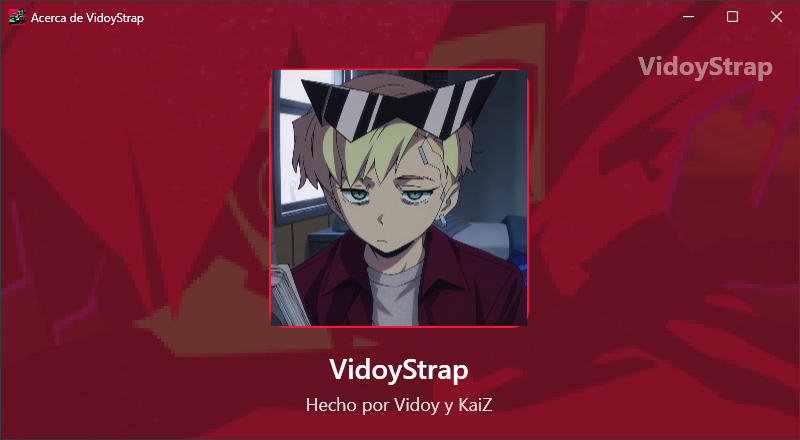

<div align="center">

# VidoyStrap

**A custom Roblox bootstrapper.** Installs, updates and launches Roblox and Roblox Studio — then hands you the controls the stock launcher keeps locked away.

[](https://github.com/KaiZ6767/vidoystrap/releases/latest)
[](https://github.com/KaiZ6767/vidoystrap/releases/latest)
[](LICENSE)

</div>



## What you actually get

### Launches Roblox the way the official launcher won't

- **One executable, no .NET install needed.** Self-contained single-file build for Windows x64 — no prerequisites, no runtime downloads.
- **Installs and updates Roblox for you**, including a full repair path when the existing install is broken or half-deleted.
- **Roblox Studio supported**, not just the player.
- **Custom bootstrap behaviour** — quiet launch, keep the bootstrapper in the tray, follow the Roblox process and clean up after it, or launch straight into a game from a shortcut.

### FastFlags, unhidden

- **A real editor for Roblox fast flags** — read, add, edit and remove them from a list, not from a hex-edited JSON file.
- **Allowlist enforced**, so a typo can't quietly disable a safety-relevant flag. (Does not apply to Roblox Studio.)
- **Community flag lists import in one paste**, and a separate fully-unlocked editor is available for people who want it.

### Global Basic Settings editor

- **Frame rate cap** — raise it, lower it, or remove it entirely.
- **Quality level, rendering and graphics toggles** without touching `GlobalBasicSettings_13.xml` by hand.
- **Applies to every place you join**, and it survives Roblox updates.

### Everything around the game

- **Deployment channel switcher** — move between production, and any other live or archived Roblox channel, and roll back when a channel misbehaves.
- **Mods folder loading** — drop replacement content, cursors, sounds and emoji fonts in `Modifications\content`; they get applied on every launch and cleanly removed when you turn them off. Presets included for the old avatar editor, old character sounds, and cursor sets.
- **Cache cleaner** — sweeps the Roblox log, cache and version folders so a corrupted install stops being a mystery.
- **Shortcuts page** — desktop/start-menu shortcuts for Roblox, Studio and VidoyStrap itself, plus shortcuts that launch a specific game directly, with real Roblox icons extracted from the install.
- **Discord Rich Presence** and **Discord join invites** — your friends see what you're playing, and invites land through the bootstrapper.
- **Activity watcher** — notices when Roblox exits and finishes the bookkeeping instead of leaving dead processes behind.

### Look and feel

- **Light, dark and "follow system" themes**, plus a custom theme editor with per-element colours.
- **Custom bootstrapper styles** — Fluent, Classic, Terminal and more, each with its own icon set, previewed before you commit.
- **Branding that stays out of the way** — the VidoyStrap wordmark and animated backdrop sit under the window content at low opacity, so nothing is obscured.
- **Localized UI** — around twenty languages shipped, English and Spanish included.

### Personalization



- **Pick the accent colour yourself** - the whole app repaints the moment you click a swatch. Neon red, red, neon violet, violet, neon green, green, neon yellow, yellow, orange, neon cyan, blue, pink, magenta and white are on the palette, and `Sistema` keeps following your Windows accent.
- **Any colour you want** - type a hex code (`#B026FF`, `#39FF14`, whatever) and hit *Aplicar*. It is stored in `Settings.json`, so it survives restarts and updates.
- **The whole interface, not just the buttons** - the accent is painted into the window shell itself, so the nav rail, cards, panels, inputs, dividers, title bar, selection rails and About frame all follow it. Text that sits on an accent surface switches to black or white automatically so bright neons stay readable.
- **Live, everywhere** - every open window repaints on the spot, including the About window and dialogs. No restart.
- **Backdrop on or off** - the animated image behind the window content is a toggle. Turn it off and the accent shell stays; the VidoyStrap wordmark stays too.
- **Animation on or off** - keep the backdrop but freeze the GIF on its first frame if you'd rather not have motion behind the text.

### Clean install, clean removal

- Installs to `%LOCALAPPDATA%\VidoyStrap`, registers itself in Windows *Apps & features*, and writes normal uninstall information.
- **The uninstaller actually removes it** — install folder, shortcuts, protocol handler, registry key and temp data.
- **Automatic update checks** against this repository's releases.



## Install

1. Grab `VidoyStrap.exe` from the [latest release](https://github.com/KaiZ6767/vidoystrap/releases/latest).
2. Run it. The installer offers a language choice, install location and shortcut options.
3. Launch Roblox from the VidoyStrap shortcut from then on — VidoyStrap registers itself as the Roblox launcher when you tell it to.

Requires **Windows 10 or newer, x64**. For macOS or Linux, VidoyStrap is not the tool you want.

Settings live in `%LOCALAPPDATA%\VidoyStrap\Settings.json`; logs live in `%TEMP%\VidoyStrap\Logs`, which is the first thing to attach to a bug report.

## Build from source

Requires the .NET SDK (the project targets `net6.0-windows`; `global.json` rolls forward to whatever major SDK you have installed) and the Windows desktop workload.

```powershell
git clone https://github.com/KaiZ6767/vidoystrap.git
cd vidoystrap
dotnet build VidoyStrap.sln -c Release
```

Single-file release build:

```powershell
dotnet publish Bloxstrap\Bloxstrap.csproj -c Release -r win-x64 --self-contained true `
  -p:PublishSingleFile=true -p:IncludeNativeLibrariesForSelfExtract=true `
  -p:EnableCompressionInSingleFile=true -p:DebugType=none -o dist
```

The WPF UI toolkit shipped in `wpfui\` is vendored source, not a submodule — it builds as part of the solution, so a plain clone is enough.

## Layout

| Path | What's in it |
|---|---|
| `Bloxstrap\Bootstrapper.cs` | Roblox install, update and launch pipeline |
| `Bloxstrap\Installer.cs` | VidoyStrap's own install, upgrade and uninstall |
| `Bloxstrap\Integrations\` | Discord RPC/invites, cache cleaner, process watcher |
| `Bloxstrap\UI\Elements\Settings\Pages\` | Every settings page |
| `Bloxstrap\UI\Utility\Branding.cs` | Accent palette, hex parsing, live resource repaint |
| `Bloxstrap\UI\Elements\Controls\BrandBackdrop.xaml` | Animated backdrop + wordmark layer |
| `Bloxstrap\Resources\` | Icons, backdrop assets, localization `.resx` files |

## Credits



Built on [Bloxstrap](https://github.com/bloxstraplabs/bloxstrap) (see `LICENSE.Bloxstrap`), with [WPF UI](https://github.com/lepoco/wpfui) for the Fluent controls. Server details via [Valra](https://github.com/NotValra)'s API.

VidoyStrap is not affiliated with Roblox Corporation or any of the projects above.

Hecho por Vidoy y KaiZ.
